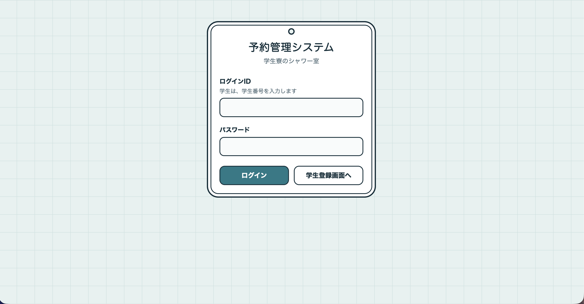
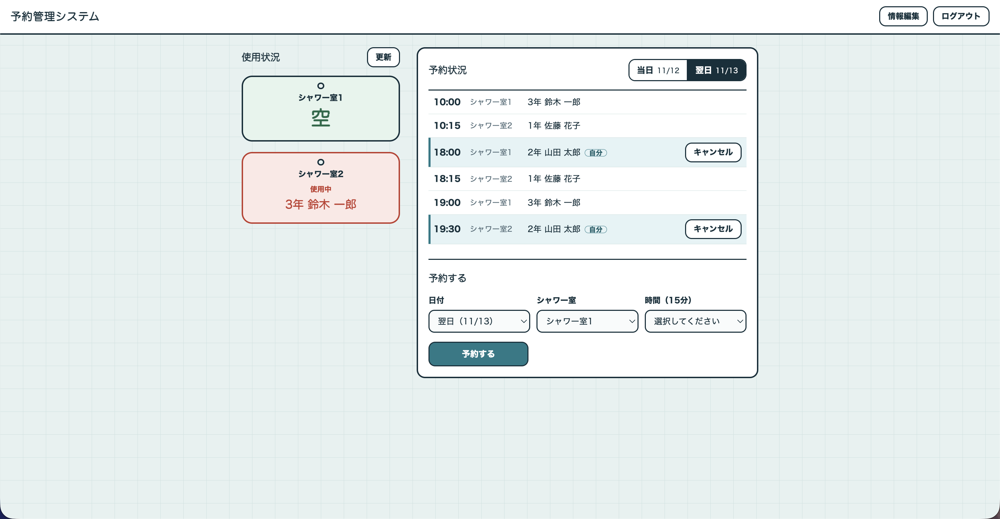
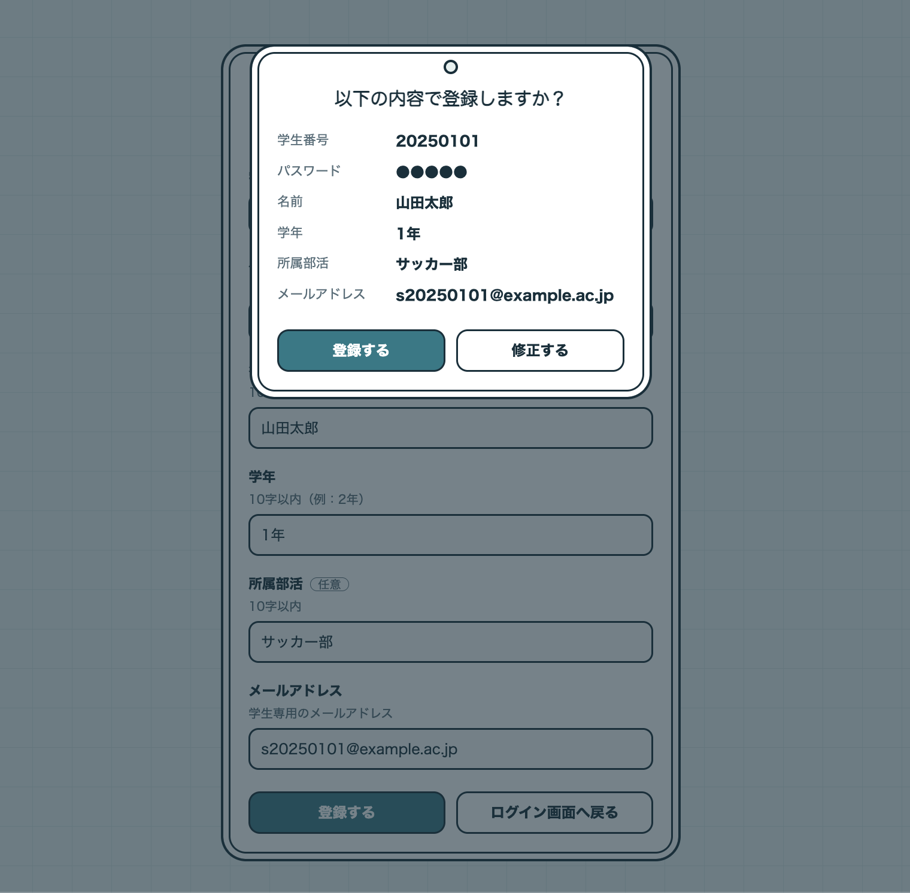
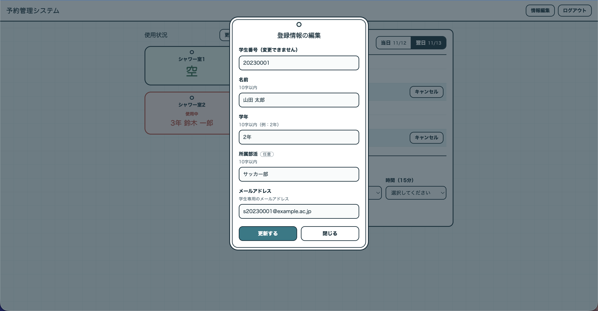
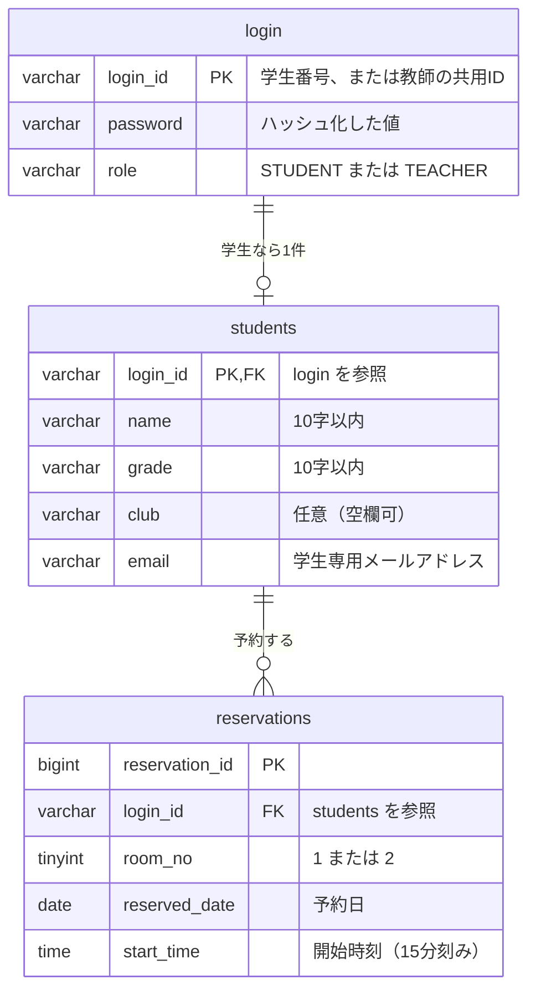
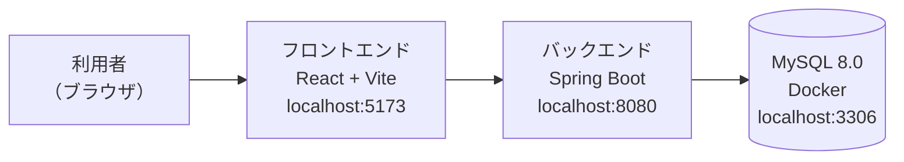

# 予約管理システム

**使用状況と予約状況をすぐに確認できる、学生寮のシャワー室の予約アプリ**

## アプリケーションの概要

学生寮のシャワー室を予約制にして、使用状況と予約状況を一目で確認できるようにするWebアプリケーションです。
1回の利用を15分に区切り、「いま誰が使っているか」と「このあと誰が予約しているか」を、画面で見られます。

- 学生：新規登録、ログイン、予約の登録・キャンセル、使用状況・予約状況の確認、自分の情報の編集
- 教師：ログイン、学生一覧の確認、不要になった学生の削除

職業訓練の最終課題として、企画・要件定義・設計から、実装までを取り組みました。

## 開発した背景や理由

私が生活していた学生寮では、土日の部活終わりや点呼後（22時）の時間帯は風呂場が使えないため、シャワーを使う学生がシャワー室の前に列を作っていました。列を見てそのまま並ぶ学生もいれば、諦めて自室に戻る学生もいました。
予約制にすれば、シャワー室まで行かなくても列の有無が分かります。また、自分のシャワーの時間が決まるので時間を有意義に使えるようになると考えて、このアプリを作りました。

## 工夫した点・苦労した点

### 工夫した点

- 二重予約をアプリ側のチェックとDB側の制約の両方で防ぎました。どちらか片方だけだと二重予約が起きるおそれがあり、学生どうしの予約がぶつかるのを防ぐためです。
- 学生専用のメールアドレスのドメインをコードに書かず、環境変数で変えられるようにしました。他の学生寮で使えるようにするためです。
- 学生と教師の権限を画面だけでなく、API側でも確認しています。学生には他の学生の情報を知る必要がなく、何かの原因で他の学生の情報を勝手に変更されないように、学生一覧の表示と削除はできないようにしました。教師は情報の整理・管理（削除など）をするので、学生一覧を見られるようにしました。画面でボタンや情報を非表示にするだけでは、APIに直接アクセスされたときに情報が漏れてしまうためです。
- 学生一覧の検索で「学生がそもそも1人も登録されていない」場合と、「検索に一致する学生がいない」場合で表示するメッセージを分けました。

### 苦労した点

- ターミナルのコマンド操作がいちばん難しかったです。やりたい操作が反映されず、エラーの表示が出ることがほとんどでした。そのたびにやりたい操作のコマンドを調べて、実行することを繰り返し、できないときはAIに聞きました。その結果、フォルダの移動や確認、Docker の起動、GitHub へのコミットとプッシュなどの操作が、自分でできるようになりました。
- 学生一覧の検索機能は、AIからあったほうがいい機能として提案を受けました。書いている途中で変数の名前が混ざってしまったり、条件を `<p>` タグの中に入れてしまったりして、うまく動かないことがありました。画面で表示を確認して、おかしなところは調べて直しました。
- READMEは、どう書けば分かりやすいか、実際の現場ではどのように書かれているのかが分かりませんでした。課題で示されたREADMEの例や、別で通っているプログラミングスクールでの書き方を参考に、AIに相談しながら、見やすい構成を目指しました。

## アプリケーションのURL

本番環境は用意していません。画面は下の「画面イメージ」で確認できます。ローカルでの起動方法は「ローカル環境での起動方法」に書いています。

## アプリケーションのデモ画像

ドアにかける「札」を画面のデザインの中心にしています。背景は浴室のタイルです。

### ログイン

学生は学生番号、教師は共用のIDでログインします。



### トップページ（学生用）

左にシャワー室ごとの使用状況を札の形で表示します（空きは緑、使用中は赤で学年と氏名を表示）。右に予約状況の一覧と予約する欄を置いています。自分の予約には「自分」の目印とキャンセルボタンが付きます。時間の選択肢は過ぎた時間を出さず、予約済みの枠や、同じ時間帯に自分の予約がある枠は選べません。



### 学生登録（入力フォーム）

寮の学生がはじめに1回だけ行います。学生番号、パスワード、名前、学年、所属部活（任意）、メールアドレスを入力します。メールアドレスは学生専用のドメインのものだけ登録できます。


### 学生登録（確認ポップアップ）

入力内容を登録の前にポップアップで確認します（パスワードは伏せ字で表示します）。



### 登録情報の編集（ポップアップ）

トップページの上に重ねて表示します。学生番号は変更できず、変更したい項目だけを書き換えて更新します。



### 学生一覧（教師用）

登録されている学生の一覧を確認できます。入力欄に名前の一部を入れると一致する学生だけに絞り込めます。卒業などで使わなくなった学生は確認のポップアップのあとに削除できます。


## 主な使用技術

| 区分 | 使用技術 |
| --- | --- |
| フロントエンド | React 19、Vite、React Router（JavaScript） |
| バックエンド | Java 21、Spring Boot 4.0（Spring MVC、Spring Data JPA）、Maven |
| 認証・認可 | Spring Security（セッション＋Cookie方式）、パスワードはBCryptでハッシュ化 |
| データベース | MySQL 8.0 |
| インフラ・開発環境 | Docker / Docker Compose（MySQLの起動）、Git / GitHub |
| テスト | Vitest、Testing Library（フロントエンド、55件） |
| 設計 | draw.io（画面遷移図・ER図・画面設計書）、Mermaid（README内の図） |

## ER図



- 同じ部屋・日付・時刻は1件だけ（ユニーク制約）。同じ学生・日付・時刻も1件だけ
- 学生を削除すると、その学生のログイン情報と予約も一緒に削除される（ON DELETE CASCADE）

## システム構成図



## ローカル環境での起動方法

### 必要な環境

- Java 21
- Node.js 20.19以上、または22.12以上
- Docker（Docker Compose）
- Git

### 手順

次の3つを同時に起動します。

1. リポジトリを取得します。

   ```
   git clone https://github.com/yuhihamada0703/shower-reservation.git
   cd shower-reservation
   ```

2. データベース（MySQL）を起動します。

   ```
   docker compose up -d
   ```

   初回起動のときに、`db/init` のSQLが自動で実行されます。作り直す場合は、`docker compose down -v` でデータを消してから、もう一度起動します。

3. バックエンド（`http://localhost:8080`）を起動します。別のターミナルで次を実行します。

   ```
   cd backend
   ./mvnw spring-boot:run
   ```

   IntelliJ IDEA で `backend` フォルダを開いて、`ReservationApplication` を実行しても起動できます。

4. フロントエンド（`http://localhost:5173`）を起動します。さらに別のターミナルで次を実行します。

   ```
   cd frontend
   npm install
   npm run dev
   ```

5. ブラウザで `http://localhost:5173` を開きます。ログインできるアカウントは「開発用のアカウント」を参照してください。

## 主な機能

| 利用者 | できること |
| --- | --- |
| 学生 | 新規登録（入力内容の確認ポップアップ付き）、ログイン、自分の情報の編集（ポップアップ）、シャワー室の使用状況の確認、予約状況（予約している学生の学年・氏名）の確認、予約の登録・キャンセル |
| 教師 | ログイン、学生一覧の確認、名前での検索（絞り込み）、卒業などで不要になった学生の削除（確認ポップアップ付き。その学生の予約も一緒に削除される） |

### 予約のルール

- シャワー室は2室、利用時間は 10:00〜23:00、1回の利用は15分（1枠）
- 予約できるのは当日と翌日だけ。過去の枠、すでに開始した枠は予約できない
- 同じ枠は先に予約した1人だけが利用できる（二重予約は、DBのユニーク制約でも防止）
- 同じ学生は同じ時間帯に1枠しか予約できない
- キャンセルは予約した本人が開始前にだけ行える
- 使用状況は「今の時刻が含まれる15分の枠」を予約している学生を使用中として表示する

## 画面の一覧

| 画面 | URL | 対象 |
| --- | --- | --- |
| ログイン | /login | 学生・教師 |
| 学生登録 | /register | 学生（ログイン前） |
| トップページ（使用状況・予約状況・予約） | /top | 学生 |
| 学生一覧 | /students | 教師 |

登録情報の編集、登録内容の確認、削除の確認はポップアップで表示します。

## ディレクトリ構成

```
.
├── frontend/           React のプロジェクト
├── backend/            Spring Boot のプロジェクト
├── db/init/            MySQL の初期化SQL（テーブル作成、初期データ）
├── docs/               設計書（企画、要件定義、ER図、画面遷移図、画面設計書、API一覧、API仕様書）と、画面のスクリーンショット（images）
├── scripts/            動作確認用のスクリプト
├── docker-compose.yml  MySQL の起動設定
└── README.md
```

## 動作確認

バックエンドを起動した状態で次のスクリプトを実行すると、予約まわりのAPIを順番に確認できます。

```
bash scripts/test-step4-2.sh
```

画面の確認用にサンプルの学生の予約を入れることもできます（実行した時刻に合わせた「使用中」の予約と、明日の予約が入ります）。消すときは`clear-sample-reservations.sql` を使います。

```
docker compose exec -T mysql mysql -u reservation_user -preservation_pass reservation_db < scripts/sample-reservations.sql
docker compose exec -T mysql mysql -u reservation_user -preservation_pass reservation_db < scripts/clear-sample-reservations.sql
```

## テスト

### バックエンド

JUnit で5件のテストが通ることを確認しています。

```
cd backend
./mvnw test
```

### フロントエンド

画面の動き（ログイン、学生登録と確認ポップアップ、使用状況・予約状況の表示、予約とキャンセル、情報編集、学生の削除、権限による画面の出し分け、入力チェック）を55件の自動テストで確認します。
バックエンドとの通信はテストの中で仮のサーバーに置き換えているので、MySQLやバックエンドを起動しなくても実行できます。

```
cd frontend
npm install
npm test
```

## 学生専用のメールアドレス

学生のメールアドレスは`@` より後ろ（ドメイン）が設定したものと同じときだけ登録できます（大文字・小文字は区別しません）。
画面（フロントエンド）とAPI（バックエンド）の両方で確認しています。リポジトリには仮のドメイン（`example.ac.jp`）が設定してあります。

| 場所 | 設定のしかた |
| --- | --- |
| バックエンド | 環境変数 `STUDENT_EMAIL_DOMAINS` に、ドメインを書く（複数のときはカンマで区切る）。指定がなければ `example.ac.jp` |
| フロントエンド | `frontend/.env.example` を `frontend/.env.local` にコピーして、`VITE_STUDENT_EMAIL_DOMAINS` を書き換える（`.env.local` は、GitHubには上げない） |

## 開発用のアカウント（学習用のダミー）

| 種類 | ログインID | パスワード |
| --- | --- | --- |
| 教師（共用アカウント） | user | admin123 |
| 学生（サンプル） | 20230001 / 20240012 / 20220005 | pass1234 |

学習用の値です。実際の運用では推測されにくいものに変更します。

## API一覧

| API | メソッド | URL | 使える人 |
| --- | --- | --- | --- |
| ログイン | POST | /login | 誰でも |
| ログアウト | POST | /logout | ログイン中の人 |
| 学生登録 | POST | /students | 誰でも |
| 自分の学生情報取得 | GET | /students/me | 学生 |
| 自分の学生情報更新 | PUT | /students/me | 学生 |
| 学生一覧取得 | GET | /students | 教師 |
| 学生削除 | DELETE | /students/{login_id} | 教師 |
| 使用状況取得 | GET | /usage | 学生 |
| 予約状況取得 | GET | /reservations | 学生 |
| 予約登録 | POST | /reservations | 学生 |
| 予約キャンセル | DELETE | /reservations/{reservation_id} | 学生 |

詳しい仕様は`docs` のAPI仕様書を参照してください。

## セキュリティについて

学習用に作ったアプリです。実装している対策と学習の範囲として、あえて対象にしていないものを分けて書きます。

### 実装している対策

- パスワードはBCryptでハッシュ化して保存し、画面にもAPIの応答にも含めない
- ログイン状態はサーバー側のセッション（Cookie）で管理する
- 権限（学生・教師）の確認は画面で隠すだけでなく、API側でも行う（ログインしていなければ401、権限がなければ403を返す）
- 学生は自分の情報と自分の予約だけを操作できる（誰のデータかは、リクエストの内容ではなく、ログイン状態から決める）
- 入力チェックは画面とAPIの両方で行う（学生専用のメールアドレスのドメインの確認を含む）
- 二重予約や、時間枠のルール違反はアプリのチェックに加えて、DBの制約（ユニーク制約、CHECK制約）でも防ぐ
- 他の学生には学年と氏名だけを表示する（ログインIDやメールアドレスは、返さない）
- 許可するメールアドレスのドメインはコードに書かず、環境変数で変えられる

### 学習の範囲として、対象にしていないもの

実際に公開して、使うときは次の対応が必要です。

- CSRF対策（現在は無効にしています）
- パスワードの長さの下限や、複雑さの確認、パスワードを変更する機能
- ログインの失敗が続いたときの制限（アカウントのロック、待ち時間など）
- HTTPS（通信の暗号化）。開発中はHTTPで動かしています
- DBのパスワードなど、秘密情報の管理（現在は学習用のダミー値を、設定ファイルに書いています）
- サンプルの認証情報（教師の `admin123` など）を、本番では使わないこと

## 今後の改善

- CSRF対策の有効化など、公開に向けたセキュリティの見直し
- 使用状況・予約状況の自動更新（現在は、更新ボタンで取得し直す）
- 予約の順番待ち（待ち番号の表示）
- パスワード変更機能
