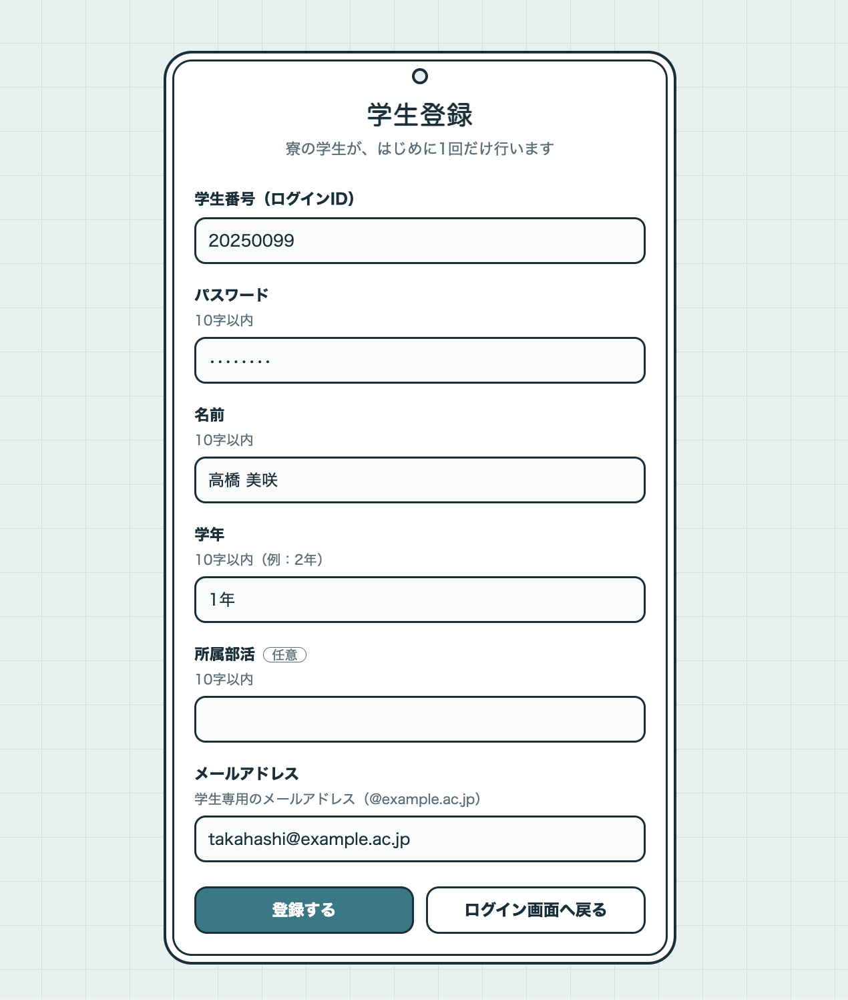
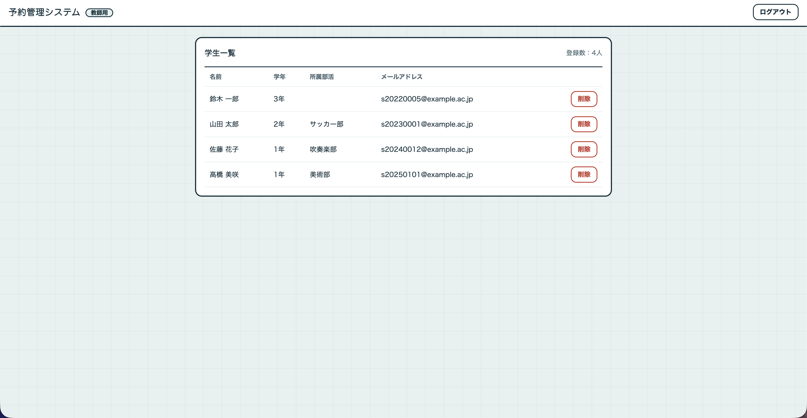
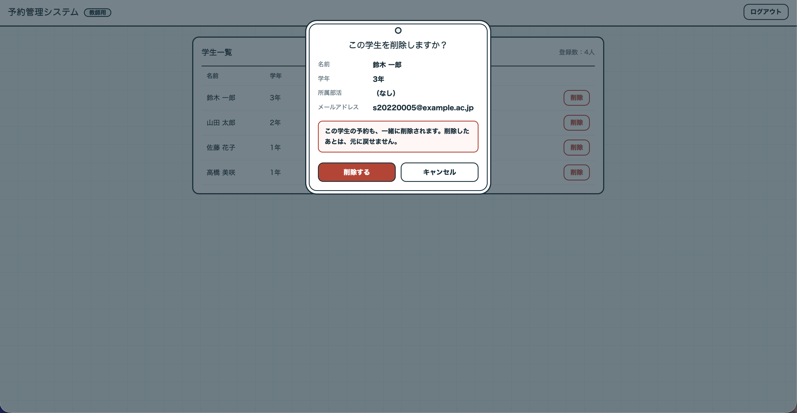
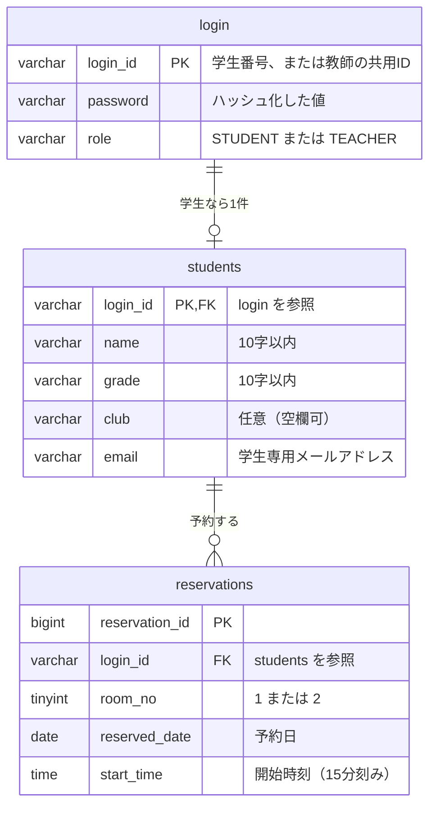
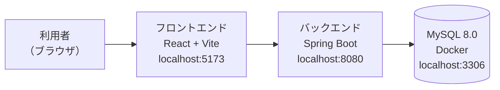

# 予約管理システム

**使用状況と予約状況を、すぐに確認できる、学生寮のシャワー室の予約アプリ**

## アプリケーションの概要

学生寮のシャワー室を、予約制にして、使用状況と予約状況を一目で確認できるようにするWebアプリケーションです。
1回の利用を15分に区切り、「いま誰が使っているか」と「このあと誰が予約しているか」を、画面で見られます。

- 学生：新規登録、ログイン、予約の登録・キャンセル、使用状況・予約状況の確認、自分の情報の編集
- 教師：ログイン、学生一覧の確認、不要になった学生の削除

職業訓練の最終課題として、企画・要件定義・設計から、実装までを取り組みました。

## 開発した背景や理由

学生寮のシャワー室は、着いた順に使う運用でした。人が並んでいるときに、自分の順番がいつ来るのかが分かりにくく、待ち時間も見通せませんでした。
そこで、1回の利用を15分に制限し、予約制にすることで、自分の順番が目に見えるようにすることを目的に、このアプリを作りました。利用するのは、寮の学生と、教師です。

## 工夫した点・苦労した点

<!-- TODO: 自分の言葉で書く（手順3で記入） -->

## アプリケーションのURL

本番環境は、用意していません。画面は、下の「画面イメージ」で確認できます。ローカルでの起動方法は、「ローカル環境での起動方法」に書いています。

## アプリケーションのデモ画像

ドアにかける「札」を、画面のデザインの中心にしています。背景は、浴室のタイルです。

### ログイン

学生は学生番号、教師は共用のIDで、ログインします。


### トップページ（学生用）

左に、シャワー室ごとの使用状況を、札の形で表示します（空きは緑、使用中は赤で、学年と氏名を表示）。右に、予約状況の一覧と、予約する欄を置いています。自分の予約には、「自分」の目印と、キャンセルボタンが付きます。時間の選択肢は、過ぎた時間を出さず、予約済みの枠や、同じ時間帯に自分の予約がある枠は、選べません。


### 学生登録（入力フォーム）

寮の学生が、はじめに1回だけ行います。学生番号、パスワード、名前、学年、所属部活（任意）、メールアドレスを入力します。メールアドレスは、学生専用のドメインのものだけ、登録できます。



### 学生登録（確認ポップアップ）

入力内容を、登録の前に、ポップアップで確認します（パスワードは、伏せ字で表示します）。


### 登録情報の編集（ポップアップ）

トップページの上に重ねて表示します。学生番号は変更できず、変更したい項目だけを書き換えて、更新します。


### 学生一覧（教師用）

卒業などで使わなくなった学生を、確認のポップアップのあとに、削除できます。





## 主な使用技術

| 区分 | 使用技術 |
| --- | --- |
| フロントエンド | React 19、Vite、React Router（JavaScript） |
| バックエンド | Java 21、Spring Boot 4.0（Spring MVC、Spring Data JPA）、Maven |
| 認証・認可 | Spring Security（セッション＋Cookie方式）、パスワードはBCryptでハッシュ化 |
| データベース | MySQL 8.0 |
| インフラ・開発環境 | Docker / Docker Compose（MySQLの起動）、Git / GitHub |
| テスト | Vitest、Testing Library（フロントエンド、55件） |
| 設計 | draw.io（画面遷移図・ER図・画面設計書）、Mermaid（README内の図） |

## ER図



- 同じ部屋・日付・時刻は、1件だけ（ユニーク制約）。同じ学生・日付・時刻も、1件だけ
- 学生を削除すると、その学生のログイン情報と予約も、一緒に削除される（ON DELETE CASCADE）

## システム構成図



## ローカル環境での起動方法

### 必要な環境

- Java 21
- Node.js 20.19以上、または22.12以上
- Docker（Docker Compose）
- Git

### 手順

次の3つを、同時に起動します。

1. リポジトリを取得します。

   ```
   git clone https://github.com/yuhihamada0703/shower-reservation.git
   cd shower-reservation
   ```

2. データベース（MySQL）を起動します。

   ```
   docker compose up -d
   ```

   初回起動のときに、`db/init` のSQLが自動で実行されます。作り直す場合は、`docker compose down -v` でデータを消してから、もう一度起動します。

3. バックエンド（`http://localhost:8080`）を起動します。別のターミナルで、次を実行します。

   ```
   cd backend
   ./mvnw spring-boot:run
   ```

   IntelliJ IDEA で `backend` フォルダを開いて、`ReservationApplication` を実行しても起動できます。

4. フロントエンド（`http://localhost:5173`）を起動します。さらに別のターミナルで、次を実行します。

   ```
   cd frontend
   npm install
   npm run dev
   ```

5. ブラウザで `http://localhost:5173` を開きます。ログインできるアカウントは、「開発用のアカウント」を参照してください。

## 主な機能

| 利用者 | できること |
| --- | --- |
| 学生 | 新規登録（入力内容の確認ポップアップ付き）、ログイン、自分の情報の編集（ポップアップ）、シャワー室の使用状況の確認、予約状況（予約している学生の学年・氏名）の確認、予約の登録・キャンセル |
| 教師 | ログイン、学生一覧の確認、卒業などで不要になった学生の削除（確認ポップアップ付き。その学生の予約も一緒に削除される） |

### 予約のルール

- シャワー室は2室、利用時間は 10:00〜23:00、1回の利用は15分（1枠）
- 予約できるのは、当日と翌日だけ。過去の枠、すでに開始した枠は予約できない
- 同じ枠は、先に予約した1人だけが利用できる（二重予約は、DBのユニーク制約でも防止）
- 同じ学生は、同じ時間帯に、1枠しか予約できない
- キャンセルは、予約した本人が、開始前にだけ行える
- 使用状況は、「今の時刻が含まれる15分の枠」を予約している学生を、使用中として表示する

## 画面の一覧

| 画面 | URL | 対象 |
| --- | --- | --- |
| ログイン | /login | 学生・教師 |
| 学生登録 | /register | 学生（ログイン前） |
| トップページ（使用状況・予約状況・予約） | /top | 学生 |
| 学生一覧 | /students | 教師 |

登録情報の編集、登録内容の確認、削除の確認は、ポップアップで表示します。

## ディレクトリ構成

```
.
├── frontend/           React のプロジェクト
├── backend/            Spring Boot のプロジェクト
├── db/init/            MySQL の初期化SQL（テーブル作成、初期データ）
├── docs/               設計書（企画、要件定義、ER図、画面遷移図、画面設計書、API一覧、API仕様書）と、画面のスクリーンショット（images）
├── scripts/            動作確認用のスクリプト
├── docker-compose.yml  MySQL の起動設定
└── README.md
```

## 動作確認

バックエンドを起動した状態で、次のスクリプトを実行すると、予約まわりのAPIを、順番に確認できます。

```
bash scripts/test-step4-2.sh
```

画面の確認用に、サンプルの学生の予約を入れることもできます（実行した時刻に合わせた「使用中」の予約と、明日の予約が入ります）。消すときは、`clear-sample-reservations.sql` を使います。

```
docker compose exec -T mysql mysql -u reservation_user -preservation_pass reservation_db < scripts/sample-reservations.sql
docker compose exec -T mysql mysql -u reservation_user -preservation_pass reservation_db < scripts/clear-sample-reservations.sql
```

## テスト

### フロントエンド

画面の動き（ログイン、学生登録と確認ポップアップ、使用状況・予約状況の表示、予約とキャンセル、情報編集、学生の削除、権限による画面の出し分け、入力チェック）を、55件の自動テストで確認します。
バックエンドとの通信は、テストの中で、仮のサーバーに置き換えているので、MySQLやバックエンドを起動しなくても、実行できます。

```
cd frontend
npm install
npm test
```

## 学生専用のメールアドレス

学生のメールアドレスは、`@` より後ろ（ドメイン）が、設定したものと同じときだけ、登録できます（大文字・小文字は区別しません）。
画面（フロントエンド）と、API（バックエンド）の両方で確認しています。リポジトリには、仮のドメイン（`example.ac.jp`）が設定してあります。

| 場所 | 設定のしかた |
| --- | --- |
| バックエンド | 環境変数 `STUDENT_EMAIL_DOMAINS` に、ドメインを書く（複数のときは、カンマで区切る）。指定がなければ `example.ac.jp` |
| フロントエンド | `frontend/.env.example` を `frontend/.env.local` にコピーして、`VITE_STUDENT_EMAIL_DOMAINS` を書き換える（`.env.local` は、GitHubには上げない） |

## 開発用のアカウント（学習用のダミー）

| 種類 | ログインID | パスワード |
| --- | --- | --- |
| 教師（共用アカウント） | user | admin123 |
| 学生（サンプル） | 20230001 / 20240012 / 20220005 | pass1234 |

学習用の値です。実際の運用では、推測されにくいものに変更します。

## API一覧

| API | メソッド | URL | 使える人 |
| --- | --- | --- | --- |
| ログイン | POST | /login | 誰でも |
| ログアウト | POST | /logout | ログイン中の人 |
| 学生登録 | POST | /students | 誰でも |
| 自分の学生情報取得 | GET | /students/me | 学生 |
| 自分の学生情報更新 | PUT | /students/me | 学生 |
| 学生一覧取得 | GET | /students | 教師 |
| 学生削除 | DELETE | /students/{login_id} | 教師 |
| 使用状況取得 | GET | /usage | 学生 |
| 予約状況取得 | GET | /reservations | 学生 |
| 予約登録 | POST | /reservations | 学生 |
| 予約キャンセル | DELETE | /reservations/{reservation_id} | 学生 |

詳しい仕様は、`docs` のAPI仕様書を参照してください。

## セキュリティについて

学習用に作ったアプリです。実装している対策と、学習の範囲として、あえて対象にしていないものを、分けて書きます。

### 実装している対策

- パスワードは、BCryptでハッシュ化して保存し、画面にもAPIの応答にも、含めない
- ログイン状態は、サーバー側のセッション（Cookie）で管理する
- 権限（学生・教師）の確認は、画面で隠すだけでなく、API側でも行う（ログインしていなければ401、権限がなければ403を返す）
- 学生は、自分の情報と自分の予約だけを、操作できる（誰のデータかは、リクエストの内容ではなく、ログイン状態から決める）
- 入力チェックは、画面とAPIの両方で行う（学生専用のメールアドレスのドメインの確認を含む）
- 二重予約や、時間枠のルール違反は、アプリのチェックに加えて、DBの制約（ユニーク制約、CHECK制約）でも防ぐ
- 他の学生には、学年と氏名だけを表示する（ログインIDやメールアドレスは、返さない）
- 許可するメールアドレスのドメインは、コードに書かず、環境変数で変えられる

### 学習の範囲として、対象にしていないもの

実際に公開して、使うときは、次の対応が必要です。

- CSRF対策（現在は、無効にしています）
- パスワードの長さの下限や、複雑さの確認、パスワードを変更する機能
- ログインの失敗が続いたときの制限（アカウントのロック、待ち時間など）
- HTTPS（通信の暗号化）。開発中は、HTTPで動かしています
- DBのパスワードなど、秘密情報の管理（現在は、学習用のダミー値を、設定ファイルに書いています）
- サンプルの認証情報（教師の `admin123` など）を、本番では、使わないこと

## 今後の改善

- CSRF対策の有効化など、公開に向けたセキュリティの見直し
- 使用状況・予約状況の自動更新（現在は、更新ボタンで取得し直す）
- 予約の順番待ち（待ち番号の表示）
- パスワード変更機能
